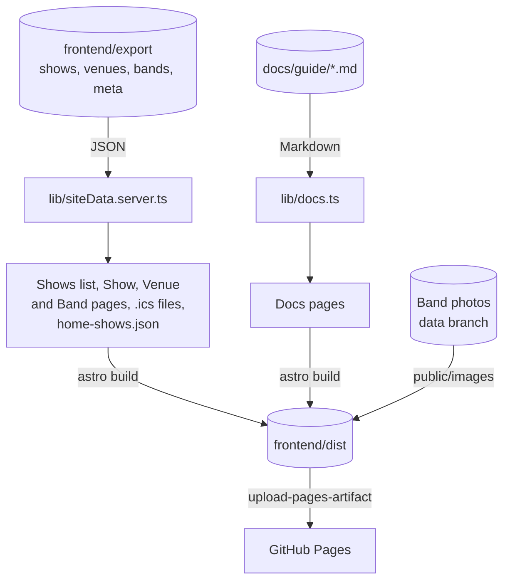
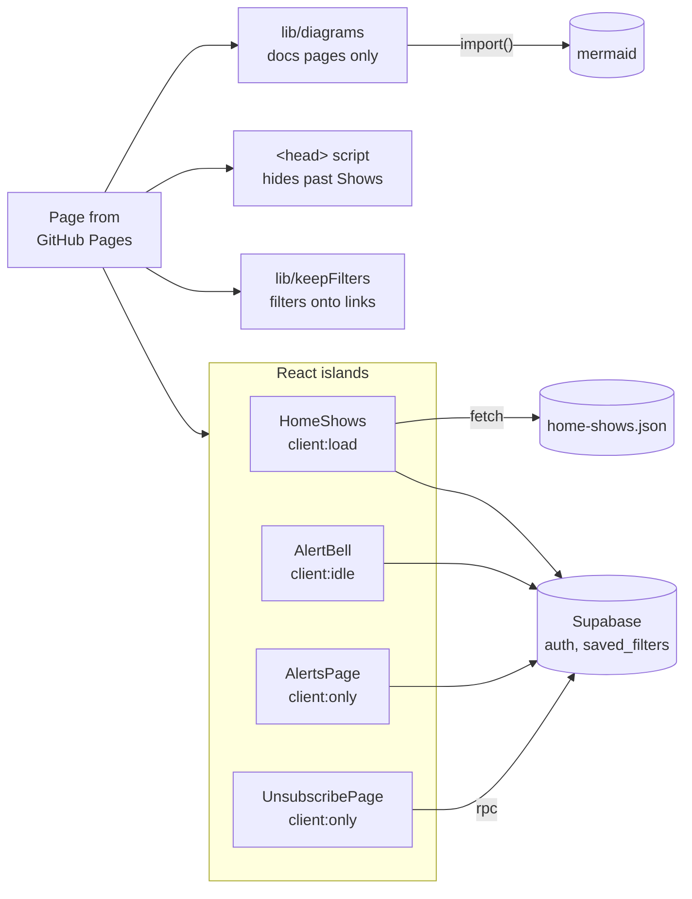
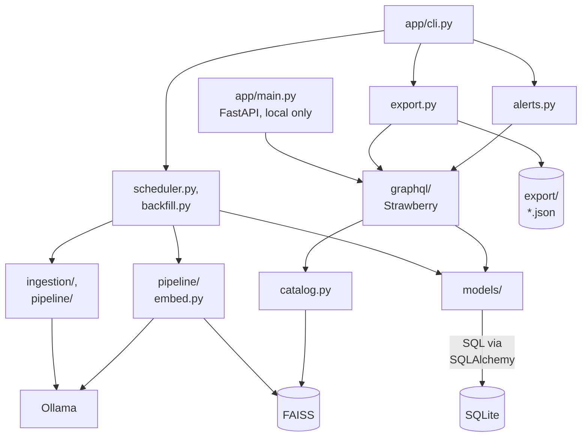
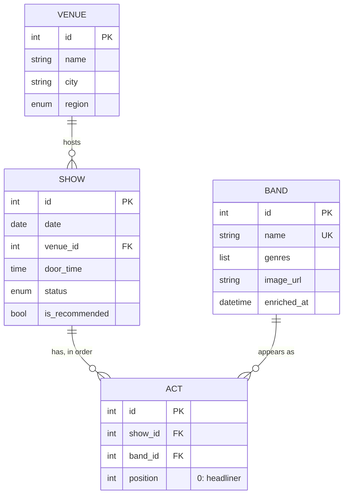
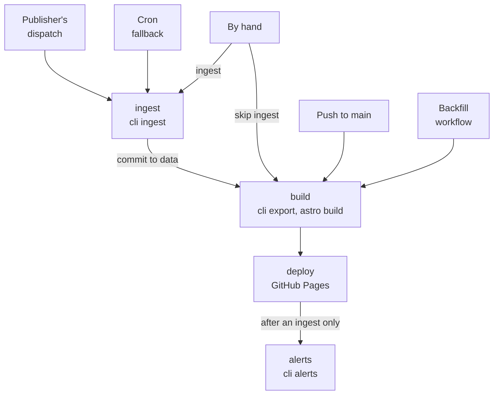
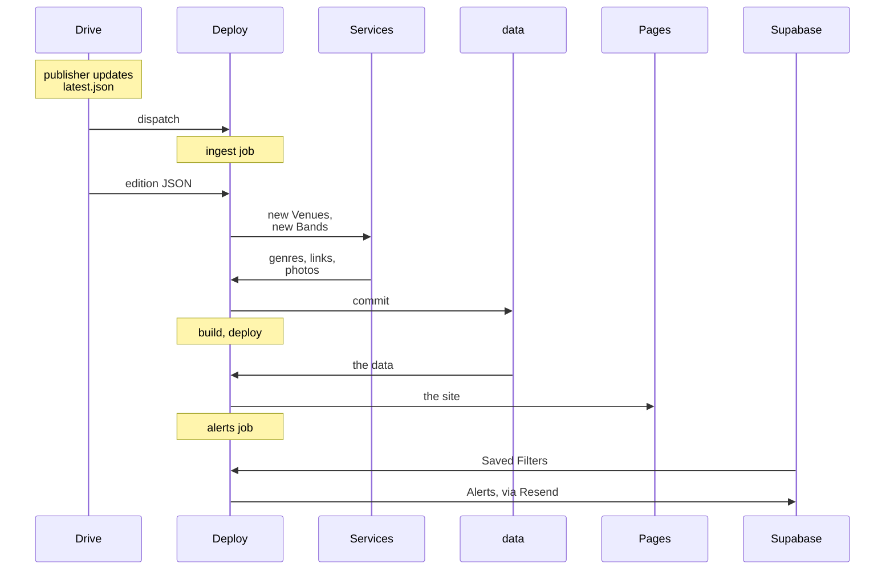

The List has three parts. The **backend** (Python, in `backend/app`) ingests each week's edition into a SQLite
database and exports it to JSON. The **frontend** (Astro, in `frontend/src`) builds a static site from that export.
The **offline jobs** (GitHub Actions and two Google Apps Scripts) run the backend each week and publish the site to
GitHub Pages. Nothing runs on a server: the published site is static files, plus Supabase for sign-in and Saved
Filters (see [ADR 0002](https://github.com/jsturgis/the_list/blob/main/docs/adr/0002-static-site-on-github-pages.md)
and [ADR 0003](https://github.com/jsturgis/the_list/blob/main/docs/adr/0003-saved-filter-alerts-on-supabase.md)).

## Frontend

### At build time

`astro build` reads the export (`shows.json`, `venues.json`, `bands.json`, `meta.json`) once, through
`lib/siteData.server.ts`, and writes every page ahead of time. Each Show, Venue and Band page is built at its Slug,
and again at its numeric URL, which redirects to the Slug. The other pages (Alerts, Unsubscribe, 404,
`robots.txt` and the sitemap) need no data. The export itself isn't published.

### In the browser

Pages arrive as finished HTML. React runs only in the islands, the parts that change in the browser
([ADR 0004](https://github.com/jsturgis/the_list/blob/main/docs/adr/0004-astro-with-react-islands.md)). Two small
scripts without React cover the rest: the inline `<head>` script hides Shows that have passed since the build, and
`lib/keepFilters` carries the Shows list's filters onto Venue links and the Back link. The browser talks to
Supabase directly; its row-level security keeps each person's Saved Filters private.

## Backend

### Modules

Everything runs from the command line (`python -m app.cli`). The GraphQL API (FastAPI and Strawberry) is for
exploring the data locally; the published site never calls it. The export and the Alerts reuse its code (the
mappers and `query_shows` in `graphql/queries.py`), so they can't drift from what the API returns.

- `cli.py` has five commands: `ingest`, `export`, `alerts`, `backfill` and `photo-focus`.
- `ingestion/` and `pipeline/enrichment.py` call the services (Google Drive, Google Places, MusicBrainz, Last.fm,
  Discogs, Wikimedia Commons, Bandcamp). Ollama runs two models: `nomic-embed-text` for embeddings, and
  `tev1:0.8b`, which judges whether a new tag is a genre (`ingestion/genre_filter.py`).
- `catalog.py` holds the read-only queries the API and the export share: filter options, Similar Bands (nearest
  in the Band FAISS index) and the latest edition's subject.
- `ingestion/band_photos.py` saves Band photos to `images/` (≤800px WebP, with a focal point from the faces in
  each, `photo_focus.py`).
- `alerts.py` reads Supabase and sends through Resend (see [Offline jobs](#offline-jobs)).

### Data

The core entities (a few fields each), as the SQLAlchemy models in `backend/app/models/` store them. A Show is at one Venue and has
its Acts in order (position 0 is the headliner); each Act is one Band's appearance. A Band's and a Show's
`embedding` is also in its FAISS index, under its id. Two tables stand alone: `ingestion_runs` (one row per ingest,
with its counts) and `genre_tags` (whether a tag is a genre, as judged once).

Saved Filters and Alert subscriptions aren't in this database: they live in Supabase (`saved_filters`,
`alert_subscriptions`; see [Weekly Alerts](alerts.md)).

## Offline jobs

### When the Deploy workflow runs

The Deploy workflow (`.github/workflows/deploy.yml`) has four jobs. An ingest happens only on the publisher's
dispatch, the cron and a manual run that doesn't skip it; Alerts go out only after an ingest. Runs share the
`pages` concurrency group with the Backfill workflow, so only one runs at a time.

- **The Drive publisher's dispatch**: when it points `latest.json` at a new edition, Friday between 6 and 7pm
  Pacific.
- **The cron**, a fallback: `37 6 * * 6`, Saturday 06:37 UTC (Friday 11:37pm PDT).
- **By hand**: Run workflow, or `gh workflow run deploy.yml`, with or without **Skip ingestion**.
- **A push to `main`** that touches the site, the backend's app or the guides.
- **The Backfill workflow**, after it commits to the `data` branch.

See [Deployment](deployment.md) for each.

### The weekly run

Steve's email arrives Friday around 5:20pm Pacific. Between 6 and 7pm the Drive publisher
(`scripts/drive-publisher.gs`, on a daily trigger) moves the new edition into the public Drive folder, points
`latest.json` at it, and dispatches the Deploy workflow. The cron runs later as a fallback: in a normal week it
finds the edition already ingested, redeploys, and sends no one a second Alert.

The services are Google Places (new Venues), and MusicBrainz, Last.fm, Discogs, Wikimedia Commons and Bandcamp
(new Bands). [How ingestion works](ingestion.md) has the ingest step by step, with what comes from each. The
Backfill workflow looks Bands ingested before a lookup existed up on the same services
(see [Deployment](deployment.md)).
