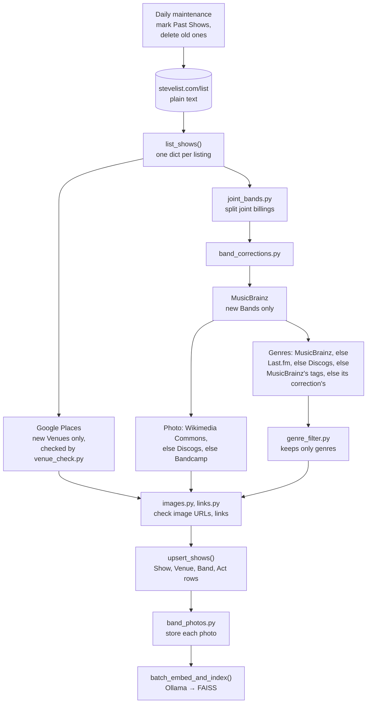

`python -m app.cli ingest` runs the steps below (`app/scheduler.py`). The List says which Shows there are, where
and when, with Steve's flags and notes; everything else about a new Band or Venue comes from the services. A Band
or Venue already in the database isn't looked up again at ingest. The Backfill workflow looks stored Bands up again (see
[Deployment](deployment.md#the-backfill-workflow)); a Venue is refreshed by hand (see
[Fixing data by hand](#fixing-data-by-hand)). For how this fits into the hourly
check, see [Architecture](architecture.md#offline-jobs).

- **The List** is the plain text of [stevelist.com/list](https://stevelist.com/list) (`app/ingestion/steve_list.py`).
  An **edition** is the page as of the date in its header; Steve also corrects the page between editions. The page's
  SHA-256 is kept on the ingestion run, which is how the hourly check (`python -m app.cli check`) tells a changed
  page. A page with no edition date, or with fewer than 20 listings, isn't taken for the List: the run fails.
- **Each listing** is parsed by `app/ingestion/parser.py`: the date, the lineup, the Venue, city and street, age,
  price, door and set times, flags, and `CANCELLED:`, `POSTPONED:` or `INCORRECT LISTING:` (also Cancelled). A
  listing's year is the edition's, or the next when that would put it more than 30 days before the edition ("jan
  15" in a November edition); for a date in the 30 days before the edition, it's the year the listing's weekday
  falls on ("oct 30 sat" in the Nov 16, 2026 edition is 2027's), and the edition's when the weekday fits neither.
  A parenthetical after a band ("Charger (record release)") is a note on its Act; one after the details ("(sold
  out)") is a note on the Show. The page is typed by hand, so typos are expected: a misspelt weekday or city is
  read as the one meant, and what can't be read goes to the Show's notes. Lines that aren't a Show ("record store
  day") are left out.
- **Venue names** are matched to stored Venues ignoring case, a leading "the", punctuation and theater/theatre,
  then by Steve's other names for a Venue (`_VENUE_ALIASES` in `app/ingestion/upsert.py`: "the Castro" is The
  Castro Theatre; "Hopmonk" is a different tavern in Novato and in Sebastopol), then by a one-typo match
  ("the Indpendent"). Only a name that matches nothing is looked up on Google Places, and joins a Venue at the
  same Google place.
- **Google's answer is checked** (`app/ingestion/venue_check.py`), because Places always offers a best guess: a
  neighbourhood for "the Castro", a bare address for a studio it doesn't know, another church for "First Church of
  the Buzzard". A result is used only when it's a place (not an area or an address), in the listing's city (Google's
  city, or a part of its address), and named like the listing: every word of one name is in the other, allowing
  Steve's typos ("the Indpendent") and short names ("the Arena" for Oakland Arena). When Places offers several
  guesses, only its exact name counts. A result that is just the listed street address keeps the address and
  coordinates, but no place id, website or phone. Anything else is dropped: the Venue is stored as listed, and the
  ingest logs `not confirmed on Google Places` with what Google offered. A nickname Google can't tie to its place
  ("the Giants Ballpark" for Oracle Park) belongs in `_VENUE_ALIASES`. The manual Venue refresh applies the same
  check before overwriting anything.
- **Joint billings** ("Dying Fetus And Sanguisugabogg") become two Bands; a Band with "and" in its name ("Belle and
  Sebastian") stays one. MusicBrainz decides (`app/ingestion/joint_bands.py`).
- **A Band's correction** (`app/ingestion/band_corrections.py`) gives the genres and links to use when the services
  have none.
- **MusicBrainz** finds the artist (the Bay Area one, when several share the name) and its links.
- **A Band's photo** is its Wikimedia Commons photo, found through MusicBrainz's Wikidata link and kept with its
  credit (`app/ingestion/wikimedia.py`); else its Discogs photo (`discogs.py`); else the band photo on its Bandcamp
  page (`bandcamp.py`). **Members** come from Discogs.
- **Genres** are MusicBrainz's curated ones, else Last.fm's tags (`app/ingestion/lastfm.py`), else Discogs' genres
  and styles (`app/ingestion/discogs.py`), else MusicBrainz's free-form tags, and only then its correction's.
  `genre_filter.py` keeps only genres: the `tev1:0.8b` model on Ollama judges a tag it hasn't seen.
- **Image URLs** are kept, repaired (Wikimedia paths) or dropped; links that don't work are dropped.
- **Band photos** still at a remote URL are downloaded, resized to ≤800px WebP and saved to the images folder
  (`app/ingestion/band_photos.py`), with a focal point from the faces in them (`photo_focus.py`).
- **Embeddings** (`nomic-embed-text` on Ollama) of each Show and its headliner go into the FAISS indices.

**Show identity** (upsert key): `(date, venue_id, door_time)`. Re-running ingestion on the same page is
idempotent. When Steve adds or corrects a door time, or lists a Show again without one (`POSTPONED:`), the listing
updates the stored Show at that Venue that day with the same headliner rather than starting another.

**What the List doesn't say** is kept: a Show's ticket link and provider, benefit cause and special event, and a
Venue's neighbourhood, type and transit came from the formatted editions ingested until November 2026, and stay on
the Shows and Venues that have them. Sold out, matinee (doors before 5pm) and benefit are read from the listing.

**Bands**: DJs (`dj …`) and back-to-back sets (`… b2b …`) are excluded. Band details from the services
only fill empty fields, so corrections made in the database aren't overwritten.

**Data retention**: shows older than `DATA_RETENTION_DAYS` (90) are hard-deleted by the daily maintenance
that runs before each ingest.

## Fixing data by hand

These change the database, so to fix the published site run them against a checkout of the `data` branch, then
commit it and redeploy, as [Deployment](deployment.md#changing-the-data-by-hand) describes. The scripts are dry runs
unless given `--apply`.

- **A Band matched to the wrong artist**, or with the wrong genres or links: add a correction for it to
  `app/ingestion/band_corrections.py` (its MusicBrainz artist, or that it's never matched by name, and the genres
  and links to use). Then look it up again: `python -m app.cli backfill --redo "<name>"`, or the Backfill
  workflow's **redo** input.
- **A tag that isn't a genre** (or one wrongly dropped): edit its row in the `genre_tags` table (`is_genre`, and
  `decided_by = 'hand'`), then run the backfill with `--recheck-genres`.
- **A Venue's details** (address, coordinates, description): the `refreshVenueEnrichment` GraphQL mutation on the
  local API looks one Venue up again (`venueId`), or every Venue without one, overwriting what's stored. It's the
  only job that uses `ANTHROPIC_API_KEY`, to tidy the name and write the description.
- **The same Band stored twice** under different spellings: `python -m app.ingestion.dedupe_bands`. Then
  `python -m app.ingestion.index_stored_vectors`, which adds any stored vector the FAISS indexes are missing, so
  the kept Band still comes up as a Similar Band.
- **The same Venue stored twice**: `python -m app.ingestion.dedupe_venues`. It merges names that differ by case or
  a leading "the", and records at the same Google place. For a typo or another name ("Hotel Utan"), first add it to
  `_VENUE_ALIASES` in `app/ingestion/upsert.py`, so later listings under that name join the Venue too.
- **A Band name that includes a set time or show details** ("The Coverups (2:30pm)"):
  `python -m app.ingestion.clean_band_names`.
