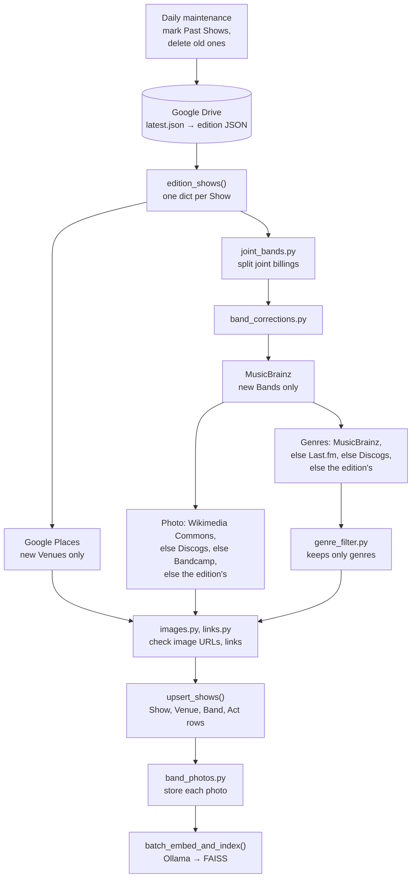

`python -m app.cli ingest` runs the steps below (`app/scheduler.py`). The services are the source of truth for a
new Band; the edition is used only when every service has nothing. A Band or Venue already in the database isn't
looked up again (the Backfill workflow does that; see [Deployment](deployment.md)). For how this fits into the weekly
run, see [Architecture](architecture.md#offline-jobs).

- **The edition**: `latest.json` points at the newest edition and, when there is one, its enriched export, which
  fills in missing Venue details, ticket links and artist images (`app/ingestion/drive.py`, `enriched.py`).
- **Joint billings** ("Dying Fetus And Sanguisugabogg") become two Bands; a Band with "and" in its name ("Belle and
  Sebastian") stays one. MusicBrainz decides (`app/ingestion/joint_bands.py`).
- **A Band's correction** (`app/ingestion/band_corrections.py`) takes the place of the edition's genres and links.
- **MusicBrainz** finds the artist (the Bay Area one, when several share the name) and its links. Its Wikidata link
  leads to the Band's photo on Wikimedia Commons, with its credit (`app/ingestion/wikimedia.py`).
- **Genres** are MusicBrainz's curated ones, else Last.fm's tags (`app/ingestion/lastfm.py`), else Discogs' genres
  and styles (`app/ingestion/discogs.py`), else MusicBrainz's free-form tags, and only then the edition's.
  `genre_filter.py` keeps only genres: the `tev1:0.8b` model on Ollama judges a tag it hasn't seen.
- **Image URLs** are kept, repaired (Wikimedia paths) or dropped; links that don't work are dropped.
- **Band photos** still at a remote URL are downloaded, resized to ≤800px WebP and saved to the images folder
  (`app/ingestion/band_photos.py`), with a focal point from the faces in them (`photo_focus.py`).
- **Embeddings** (`nomic-embed-text` on Ollama) of each Show and its headliner go into the FAISS indices.

**Show identity** (upsert key): `(date, venue_id, door_time)`. Re-running ingestion on the same edition
is idempotent.

**Bands**: DJs (`dj …`) and back-to-back sets (`… b2b …`) are excluded. Band details from the edition
only fill empty fields, so corrections made in the database aren't overwritten.

**Data retention**: shows older than `DATA_RETENTION_DAYS` (90) are hard-deleted by the daily maintenance
that runs before each ingest.
